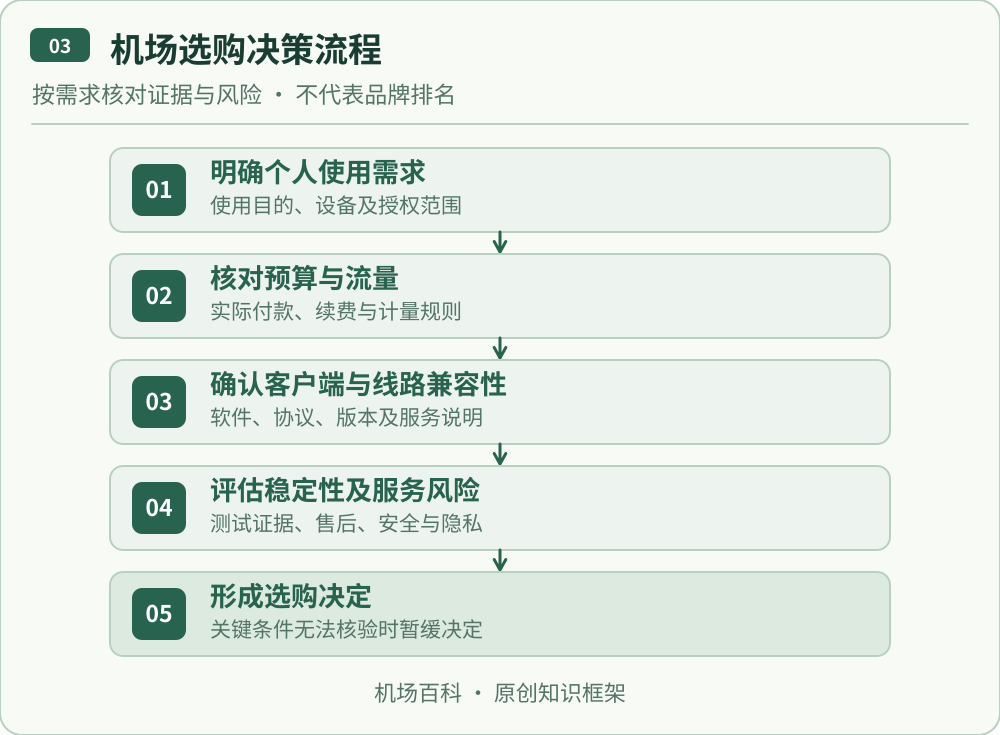

# 2026 机场推荐与选购指南｜机场百科 Jichang Wiki

<!-- V1.1.0 更新文件：上传后生效。 -->

机场百科是一份面向中文读者的原创网络知识资料库。如果你正在寻找机场推荐，或者面对不同价格、线路、节点数量和客户端支持情况，不知道该如何比较，可以从这里建立自己的选择标准。

本指南以选购知识、服务规格、测评方法和网络技术为主，并提供八家机场的商业推荐参考，不将推荐顺序作为未经核验的性能排行榜。没有一种服务能够保证适合所有人，合理的选择取决于实际需求、预算、使用环境和风险承受能力。

**内容导航：** 项目介绍 · 2026八家机场推荐 · 机场选购 · 服务规格对比 · 六大知识分类 · 延伸阅读 · 资料与披露 · FAQ。

## 关于机场百科 Jichang Wiki

### 机场百科是什么？

在中文网络语境中，“机场”通常指通过订阅方式提供代理节点的网络服务，并不是传统意义上的航空机场。“梯子”则是较宽泛的俗称，可能指代理服务、VPN 或其他相关网络工具。两者都不是严格的技术分类。

机场百科围绕这些概念整理知识，但不将某一种协议、客户端或线路名称直接等同于服务质量。理解工具的工作边界，比记住品牌名称更有长期价值。

### 本项目能够帮助你解决哪些问题？

你可以了解如何阅读套餐说明、比较实际使用成本、分辨测速数据与营销宣传、理解订阅和客户端的关系，以及识别长期付款和个人信息方面的风险。即使不同服务商更换套餐，基本判断方法仍然适用。

### 内容研究与维护原则

项目区分官方资料、真实测试和第三方信息。服务商公开的规格只能证明其公开作出了相应说明，不能直接证明实际性能。本项目不出售订阅或提供免费节点资源。使用网络服务时，应遵守所在地适用的法律法规及相关平台条款。

## 2026八家机场推荐

以下为站长选购推荐顺序，不代表独立测速或综合性能排名。选购前请核对服务条款、最新套餐、客户端兼容性及退款规则。

### 商业推广声明

本站部分推荐涉及商业合作与联盟推广。通过推广链接购买服务，本站不会向用户额外收取费用。推广佣金是维持本站持续运营及原创内容更新的收入来源之一。

具体利益关系见 [商业关系与推广披露](DISCLOSURE.md)。

下表为运营方确认的月付套餐参考，具体价格、流量及优惠以服务商实际结算页面为准。

| 机场品牌 | 推荐定位 | 月付套餐参考 | 推广入口 |
| --- | --- | --- | --- |
| **浪网 WaveNet**（[品牌利益关系](DISCLOSURE.md#关联内容品牌与自有业务)） | 站长首选 | ¥30/月 | [推广入口](https://lw.wavenetaff.com/#/?code=veqCSxNn) |
| 暮光网络 | 主推机场 | ¥20/月；120GB/月 | [推广入口](https://lw.twilightaff.com/#/?code=wFdOPUP4) |
| 微风网络 | 主推机场 | ¥25/月；200GB/月 | [推广入口](https://edp01.breezenetaff.com/#/?code=88jnWV4Z) |
| 飞猫云 | 主推机场 | ¥25/月；150GB/月 | [推广入口](https://flycat1.flycatvipaff.cc/#/?code=0V34nZhm) |
| 大佬云 | 主推机场 | ¥19.99/月；100GB/月 | [推广入口](https://a01vipaff.dalaoyunaff.com/#/?code=XhvV3U4h) |
| 飞V | 主推机场 | ¥25/月；150GB/月 | [推广入口](https://lw.flyvaff.com/#/?code=CKzLGwN2) |
| 灵动云 | 主推机场 | ¥20/月；100GB/月 | [推广入口](https://lw.lingdongaff.com/#/?code=KN4egq9h) |
| 隐形人 | 主推机场 | ¥24/月；144GB/月 | [推广入口](https://lw.invisibleaff.com/#/?code=r9aWwmfL) |

上述入口为带推广识别参数的服务商入口。价格、优惠与可用性以实际服务商页面为准。未对上述八家进行统一环境下的独立性能测试。

## 2026年机场推荐：如何选择适合自己的机场？

### 新手选择机场前需要了解什么？

先区分三个对象：服务商负责提供网络资源及账户服务；节点是客户端用于建立连接的配置对象；客户端是运行在设备上的软件。购买服务与取得客户端并不是同一回事，部分客户端可能单独收费。

选购前应确认设备系统、服务支持范围、套餐生效及续费方式、售后联系渠道。若购买目的不明确，即使选择了流量最多的套餐，也未必能得到更好的体验。对于需要了解梯子推荐的新手，建议先阅读[入门选购指南](docs/guides/tizi-guide.md)，再比较各项规格。

### 不同使用需求应该关注哪些指标？

以下表格不是品牌排名，而是机场百科整理的需求匹配方法。

| 用户类型 | 优先关注 | 需要额外确认 |
| --- | --- | --- |
| 预算有限 | 实际支出、按量成本 | 流量有效期与退款条件 |
| 初次接触 | 使用说明、客服渠道 | 设备与软件兼容性 |
| 高频使用 | 流量余额、持续传输表现 | 限速条件与故障恢复 |
| 多设备使用 | 同时在线限制 | 不同操作系统的支持范围 |
| 工作或远程协作 | 可用性、延迟变化 | 企业授权、安全要求和备用方案 |

一项规格只有与需求对应时才有意义。例如，不经常使用网络服务的人不一定需要大流量；需要长时间保持连接的人则不能仅凭一次峰值速度作决定。对于重要工作，应优先采用组织授权的网络方案，避免把关键业务完全依赖于未经评估的第三方服务。

### 便宜机场与高价机场有什么区别？

价格可能受到带宽成本、共享程度、服务支持、运营方式和促销活动影响。高价并不自动意味着稳定，低价也不能直接证明质量差。比较便宜机场时，除了首期优惠，还应关注续费价格、重置周期、额外收费以及未使用流量是否失效。

不少套餐以年付折算月价，但折算金额不等于实际每月支付金额。长期预付还会带来服务中断后未消费资金无法收回的风险。[价格、流量与实际使用成本分析](docs/guides/budget-airports.md)进一步讨论这类问题。

### 如何判断机场是否稳定可靠？

稳定性是一段时间内的表现，不是一次测速的结果。服务能否连接、连接后能否持续传输、故障是否集中于某些时间，以及服务方是否及时说明问题，都需要分别观察。

本地 Wi-Fi、设备负载、互联网接入商和目标服务器同样可能影响测试。因此，看到连接异常时，不能直接断定机场已经故障；看到一次高速结果，也不能推断长期可靠。关于观察周期和风险判断，参阅[稳定性指南](docs/reviews/stability-guide.md)。

### 选择好用机场的七项参考标准

1. **费用透明：** 付款前能够清楚了解总价、续费方式与额外收费。
2. **流量合适：** 套餐容量、有效期和计量规则符合实际需求。
3. **连接可靠：** 有可追溯的长期观察，而不是仅有宣传数字。
4. **设备兼容：** 软件与操作系统支持情况明确。
5. **使用体验：** 说明容易理解，日常操作不需要频繁求助。
6. **售后清晰：** 故障反馈和退款政策有明确依据。
7. **安全可评估：** 能够了解运营主体、隐私规则和必要权限。

这些标准不设统一的总分。对于不同用户，指标的重要性可能不同；安全或关键兼容性要求无法满足时，也不应通过低价格来抵消。详见[普通用户的七项选择标准](docs/faq/good-airport.md)。

## 机场服务规格、套餐与线路对比

### 机场套餐价格与流量如何比较？

月均费用可用完整付款金额除以对应服务月数来估算。单位标称流量成本则可用同一周期费用除以该周期可用的标称流量。比较前要统一币种、有效期和计量规则，避免拿总流量与每月重置流量直接比较。

举例：下面两个套餐是为了说明计算方法而设计的假设方案，不对应任何真实机场，不是报价或实测数据。

| 假设方案 | 付款方式 | 每月标称流量 | 月均费用 | 每 GB 标称成本 |
| --- | --- | --- | --- | --- |
| A | 20元/月 | 100 GB | 20元 | 0.20元 |
| B | 180元/年 | 100 GB | 15元 | 0.15元 |

假设两个方案均按月重置、没有额外费用，并且连续提供完整服务，B 的月均价格较低，但需要一次支付180元。如果只使用一个月，或者服务提前终止且不能退款，折算价格就不足以反映实际损失。未使用流量也会影响真实使用成本。

### IEPL、IPLC、中转与直连线路

IEPL 是国际以太网专线，IPLC 通常指国际私有租用电路，均属于国际通信连接服务相关概念。两者的具体交付接口、带宽和保障范围应以运营商合同为准。可参考运营商 [中国电信欧洲 IEPL 产品说明](https://www.chinatelecomeurope.com/product/iepl/)及 [Airtel 国际专线服务说明](https://www.airtel.in/b2b/international-private-line)。

“直连”和“中转”更多是在描述连接路径组织方式，不是与 IEPL、IPLC 完全对应的分类。使用中转不代表一定租用了国际专线；宣传中出现专线名称，也无法据此判断用户端到目标端的每一段连接方式。

网络路径越复杂，越需要明确测试范围。企业专线的合同指标不能直接套用到共享代理服务。详见[机场线路区别](docs/network/line-types.md)。

### 机场节点与客户端兼容性

一个节点通常包含连接所需的地址、协议及认证等参数，一个订阅则可能提供一组节点或完整配置。多个节点不一定对应相同数量的独立服务器，节点名称也不能证明出口所在地或资源独享情况。

所谓 Clash机场，通常是指宣称支持 Clash 系列客户端或相应配置格式的服务，并不是一种统一的线路标准。实际兼容性取决于客户端、内核版本、协议及配置结构。[Mihomo 官方配置说明](https://wiki.metacubex.one/en/config/)与[代理集合文档](https://wiki.metacubex.one/en/config/proxy-providers/content/)说明了相关配置形式。

Clash Verge Rev 与 v2rayN 均有桌面系统版本，v2rayNG 面向 Android；小火箭（Shadowrocket）是独立网络工具，并不附带代理服务。软件的支持范围应以各自官方说明为准，不建议使用来源不明的修改版安装包。

延伸阅读：[节点百科](docs/nodes/airport-nodes.md)、[Clash机场兼容性指南](docs/clients/clash-airport.md)、[客户端对比](docs/clients/client-comparison.md)。

### 如何正确理解机场测评数据？

延迟是时间指标，吞吐量描述单位时间内实际传输的数据量，丢包率用于描述测量中未成功到达的数据包比例。它们相关但不等价。低延迟不能保证大文件下载速度，瞬间高速也不能证明连接始终可靠。

参考 [RFC 2681 往返延迟测量](https://www.rfc-editor.org/info/rfc2681/)和 [RFC 7680 单向丢包测量](https://www.rfc-editor.org/info/rfc7680/)，比较数据时应关注测量对象、时间范围及判定条件。民用客户端展示的延迟数字不一定采用相同测量方法，不能无条件横向比较。

阅读机场测评时，可检查六项核心维度：连接可用性、延迟与变化、实际吞吐量、丢包与中断、套餐及价格、客服与售后。若测试没有记录环境、日期和样本数量，结论只宜作为有限参考。

详见[测评方法](docs/reviews/review-methodology.md)与[网络性能知识](docs/network/network-performance.md)。

### 机场服务规格参考表

| 比较维度 | 需要核验的资料 | 常见误区 |
| --- | --- | --- |
| 价格 | 原价、续费、付款周期 | 将首期优惠视为永久价格 |
| 流量 | 有效期、重置、计量规则 | 将年总量当成每月流量 |
| 线路 | 官方说明、实际证据 | 将线路名称当成性能保证 |
| 兼容性 | 软件、协议与版本要求 | 认为所有订阅均可通用 |
| 稳定性 | 不同时段的完整测试记录 | 只比较最快的一次结果 |
| 服务支持 | 退款条件、故障反馈渠道 | 将宣传承诺等同于可执行保障 |
| 安全与隐私 | 运营主体、权限、隐私条款 | 把加密等同于完全匿名 |

本指南的商业推荐名单不等同于具体服务品牌的实测规格对比或性能名次。读者可使用上述参考方法核对所选服务的实际价格、服务条款与相关证据。没有资料的指标应标记为未知，而不是估算为零或默认表现优秀。

## 机场百科原创知识资料库

### 机场选购

- [梯子推荐怎么选？新手网络工具选购指南](docs/guides/tizi-guide.md)：从设备、费用、服务范围和安全需求建立入门选择思路。
- [便宜机场怎么选？价格、流量与实际使用成本分析](docs/guides/budget-airports.md)：理解套餐折算、流量有效期及长期付款风险。

### 机场测评

- [机场测评怎么看？六项核心指标与评价方法](docs/reviews/review-methodology.md)：辨别测试记录、测量条件和服务商宣传之间的差别。
- [稳定机场如何判断？网络稳定性与长期使用风险](docs/reviews/stability-guide.md)：理解连接波动、故障恢复和长期可靠性。

### 节点百科

- [机场节点是什么？代理节点、订阅与服务器详解](docs/nodes/airport-nodes.md)：梳理网络服务的基本组成与术语关系。
- [VLESS、VMess、Trojan与Shadowsocks有什么区别？](docs/nodes/proxy-protocols.md)：理解协议用途、设计差异与兼容性边界。

### 客户端指南

- [Clash机场怎么选？订阅格式与客户端兼容性指南](docs/clients/clash-airport.md)：理解配置格式及不同内核的支持范围。
- [Clash Verge Rev、v2rayN、v2rayNG与小火箭有什么区别？](docs/clients/client-comparison.md)：比较软件定位、系统支持及使用边界。

### 网络技术

- [IEPL、IPLC、中转与直连线路有什么区别？](docs/network/line-types.md)：区分通信服务概念与连接路径组织方式。
- [网络延迟、速度与丢包率：如何理解真实网络体验？](docs/network/network-performance.md)：理解网络质量指标，不将单次测速当成综合评价。

### 常见问题

- [什么才算好用的机场？普通用户的七项选择标准](docs/faq/good-airport.md)：建立与个人需求相关的选择框架。
- [机场避坑指南：免费节点、长期套餐与订阅安全](docs/faq/airport-risks.md)：了解不明来源服务、预付费及凭据泄露的潜在风险。

## 相关知识项目与延伸阅读

### 网络工具选购与技术资料

如需确认软件支持范围，应优先查阅维护者的原始资料，而不是仅依赖下载站或推广介绍。

- [Mihomo 官方文档](https://wiki.metacubex.one/en/config/)：了解配置结构。
- [Clash Verge Rev 官方项目](https://github.com/clash-verge-rev/clash-verge-rev)、[v2rayN 官方项目](https://github.com/2dust/v2rayN)、[v2rayNG 官方项目](https://github.com/2dust/v2rayNG)：核对客户端说明。
- [Shadowrocket 的 App Store 页面](https://apps.apple.com/my/app/shadowrocket/id932747118)：核对软件说明；实际可获得性取决于所在地区及账户条件。

### 网络实验与套餐研究

网络性能可延伸阅读 [RFC Editor](https://www.rfc-editor.org/)，理解测量定义。套餐费用则应优先核对实际服务条款。关联博客文章仅在核验具体页面的内容与链接后纳入本节。

## 资料来源、商业披露及更新记录

### 资料来源与核验标准

A级为官方技术文档、源码及官方资料；B级为有记录的实际测试；C级为可核实第三方资料；D级为未核实信息，不作为确定事实发布。资料等级说明来源性质，不保证所有官方声明均已独立证实。详细记录见 [SOURCES.md](SOURCES.md)。

### 商业关系与推广披露

商业推广声明见推荐模块，具体品牌利益关系及编辑原则见 [DISCLOSURE.md](DISCLOSURE.md)。商业合作不能替代性能证据。

### 内容更新记录

当前指南以2026年为内容整理年度，首次内容整理日期为2026年11月20日。本项目于2026年11月22日首次公开。V1.1.0 增加八家机场推荐，并将常见问题集中于页面末尾。重要修订将在 [CHANGELOG.md](CHANGELOG.md) 中记录，不以修改日期代替资料核验。技术内容按季度复核，服务资料和外链定期检查；不保证未核验服务的实时可用性。

### 内容许可证与品牌标识

运营方有权授权的原创正文与 `assets/diagrams/` 中的原创知识图采用 [CC BY-NC-ND 4.0](LICENSE)。署名使用机场百科（Jichang Wiki），保留原始来源与许可信息，不授予商业转载或公开分发改编作品的许可。`assets/logo/` 内的标识、`assets/images/social-preview.png` 品牌封面、品牌名称、管理文件（SOURCES.md、DISCLOSURE.md、CHANGELOG.md、CONTRIBUTING.md）及第三方引用资料不纳入该授权；各自权利、适用的法定例外与 GitHub 平台条款不受削减。不授予商标权，额外许可须单独确认。许可证全文见 LICENSE，正式条款以 [Creative Commons 官方法律文本](https://creativecommons.org/licenses/by-nc-nd/4.0/legalcode.en) 为准。

品牌及知识图中的文字使用 Noto Sans CJK SC 2.004（Regular / Bold），源字体采用 [SIL Open Font License 1.1](https://github.com/notofonts/noto-cjk/blob/main/Sans/LICENSE)；图中文字为轮廓或栅格化呈现，仓库不分发字体文件。字库权利不属于本项目的 CC 授权范围。

### 参与贡献与错误反馈

欢迎依据公开资料提出更正和补充，具体方式见 [CONTRIBUTING.md](CONTRIBUTING.md)。反馈时请勿公开个人账户、订阅凭据及其他敏感信息。

## 机场推荐与网络工具常见问题（FAQ）

### 网络语境中的机场是什么意思？

机场是代理节点订阅服务的俗称，服务通常涉及账户、节点配置、流量或有效期等内容。它不是统一的网络协议，也不必然与 VPN 等同。[了解机场节点](docs/nodes/airport-nodes.md)。

### 2026年机场推荐应该参考哪些标准？

优先核对最新服务条款、实际费用、设备兼容性、安全规则及有时间记录的网络表现。年份不是品质证明，也不能以旧测评替代当前核验。[七项选择标准](docs/faq/good-airport.md)。

### 新手如何选择合适的梯子？

先明确合法使用目的、设备系统及预算，再查看服务说明、软件来源和售后条件。不确定的功能应先向服务方核实，不要因单一推荐就作长期付款决定。[新手选购指南](docs/guides/tizi-guide.md)。

### 便宜机场值得购买吗？

价格低不一定代表质量差，但必须了解流量、实际续费价格、有效期及限制条件。若关键信息无法核验，就不能仅凭价格判断性价比。[成本分析](docs/guides/budget-airports.md)。

### 如何判断机场测评是否可信？

查看测试日期、接入网络、测量指标、样本数量和商业利益披露。仅展示最快速度或没有测试记录的推荐，不足以支持全面的性能结论。[测评方法](docs/reviews/review-methodology.md)。

### 稳定机场应该具备哪些条件？

应当能够提供符合需求的持续连接表现，并有明确的异常反馈和维护机制。稳定程度需要长期观察，不宜凭节点数量或线路名称推测。[稳定性指南](docs/reviews/stability-guide.md)。

### 机场节点与订阅链接有什么区别？

节点指单个逻辑连接配置，订阅链接通常用于获取一组配置或更新资料。订阅地址可能含有私人访问凭据，不能当作普通链接公开分享。[节点百科](docs/nodes/airport-nodes.md)。

### Clash机场是什么意思？

它通常指声称提供 Clash 相关配置支持的服务。这个名称不能证明其协议全部兼容，更不代表软件、线路及服务质量都已经过验证。[兼容性指南](docs/clients/clash-airport.md)。

### IEPL与IPLC线路有什么区别？

两者是国际通信服务相关术语，IEPL 强调以太网连接形式，IPLC 指国际租用专用电路。具体服务和保障范围需要查阅运营商的说明与合同。[线路知识](docs/network/line-types.md)。

### 网络延迟低就代表速度快吗？

不一定。延迟衡量响应所需时间，吞吐量衡量实际数据传输能力。拥塞、丢包、服务器性能及测量方法都会影响体验。[网络性能](docs/network/network-performance.md)。

### 免费机场节点存在哪些风险？

来源不明的节点可能存在服务不稳定、运营主体不清楚或隐私风险。应避免向第三方公开订阅凭据，也不应信任来源不明的证书和软件。[机场避坑指南](docs/faq/airport-risks.md)。

### 机场月付和年付应该如何选择？

月付通常使首次支出较小；年付可能具有折扣，但同时承担更长的预付费风险。应结合实际需求、退款规定及已核验的服务记录判断。[费用分析](docs/guides/budget-airports.md)与[风险指南](docs/faq/airport-risks.md)。
