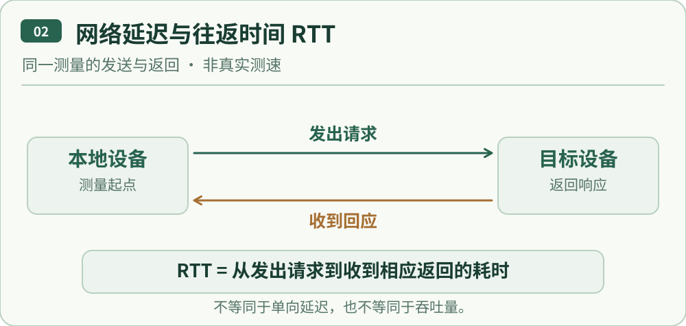

# 网络延迟、速度与丢包率：如何理解真实网络体验？

<!-- 机场百科｜文章10｜V1.0 最新审核稿｜首次完整正文，未发布｜2026-11-20 -->

网络延迟低是否等于网速快？为何测速结果很好，实时语音仍会断断续续？这些问题反映的是不同的网络性能维度。理解网络延迟与丢包率的基础概念，能够帮助用户避免只凭某一个数字评价所有网络体验。本文介绍一般 IP 网络的性能指标，所有算例均为教学假设，不涉及实际服务商测试。

## 网络性能主要包含哪些指标？

| 指标 | 常见单位 | 主要反映的现象 |
| --- | --- | --- |
| 往返延迟 RTT | ms | 请求及相应回复的耗时 |
| 带宽 | Mbps 等 | 通信资源的容量或规格 |
| 吞吐量 | Mbps 等 | 一段时间内实际传输速率 |
| 丢包率 | % | 定义的测量中未抵达的数据包比例 |
| 延迟变化 | ms 等 | 数据包时延的变化情况 |

这些指标描述的对象不同，必须结合测量方向、目标和应用需求理解。连接可用性和中断时间也是用户体验的重要方面，但并不等同于上述任一指标。

## Ping值与RTT是什么意思？

RTT 是 Round-Trip Time 的缩写，即往返时间。RFC 2681 为 IP 网络往返延迟提供了指标定义。通俗理解，就是测量某个请求从发出到得到相应返回之间的耗时。

Ping 是常用的网络诊断工具名称，通常涉及 ICMP 回显请求与响应。软件界面中有时也使用“Ping”描述其他形式的连接测试，因此需要确认工具测量的具体内容。目标设备不回复 ICMP 并不等于所有应用连接都无法通信。

RTT 也不是单向延迟；两条方向上的路径和处理条件可能不同，因此不能在所有情况下简单除以二得到准确的单向时间。比较两个延迟数字前，首先确认使用相同的测量目标、方法及环境。

## 带宽与实际吞吐量有什么区别？

带宽常用于表达链路或服务提供的容量，吞吐量则关注实际传输情况。一份100 Mbps 的连接规格并不意味着每次下载都会获得100 Mbps 的应用有效数据速率。协议开销、其他流量、设备以及目标端处理能力都会影响实际结果。RFC 6349 对 TCP 吞吐测试提供了专门框架。

单位也要注意：Mbps 中的小写 b 表示比特，MB/s 中的大写 B 表示字节。采用十进制单位时，80 Mbps 在纯单位换算上相当于10 MB/s；实际应用数据传输还可能存在额外开销，不可直接据此保证下载速度。假设传输了100 MB 的有效文件数据且耗时20秒，平均有效数据速率为5 MB/s，即40 Mbps。

## 网络丢包率如何理解？

RFC 7680 对 IP 性能测量中的单向丢包作出定义，强调测量对象和判定条件。对普通读者，可以将丢包率理解为在明确的测试规则下，未成功抵达的包占样本总数的比例。

假设进行100次指定类型的数据包测试，有3次符合未抵达的判定，则本组测量的丢包比例为3%。如果随后由另一工具测得不同数字，应先比较方法，包括超时阈值、目标及数据包类型，而不是直接选择较好看的数值。

丢包可能触发部分通信机制进行重传，从而影响有效吞吐量或任务完成时间。实时应用对迟到或丢失的数据可能采用与文件传输不同的处理方式。具体体验取决于应用设计和发生异常的方式，不能为所有应用规定同一个绝对可接受的丢包阈值。

## 网络抖动与连接波动

RFC 5481 讨论了数据包时延变化及其不同测量方式。日常所说的抖动并没有在所有软件中使用相同算法，某些工具统计相邻样本差异，另一些则采用不同参考值。读者应记录工具给出的指标定义，不直接比较名称相同但统计方法不同的结果。

例如以下两个假设的 RTT 样本，平均值相同，但变化分布明显不同：

| 虚构记录 | 5次往返延迟（ms） | 均值 |
| --- | --- | --- |
| 甲 | 40、42、41、39、38 | 40 ms |
| 乙 | 10、70、15、65、40 | 40 ms |

甲的极差为4 ms，乙为60 ms。极差只是样本范围指标，并不是标准定义下的抖动测量结果。示例说明均值可能隐藏变化，不证明任一虚构连接的实际质量。

## 为什么低延迟不一定代表高速？

延迟主要回答等待多久，吞吐量主要回答一段时间传输了多少数据。两者可能相关，但不是同一件事。一个距离较近、容量较小的资源可以较快响应少量请求，却不一定能持续传输大量数据；一个容量较大的路径也可能存在更明显的往返等待时间。

具体应用还涉及请求次数、传输协议行为、服务器处理以及缓存。看到低 Ping 数字时，不要把它直接写成“下载速度高”的证据。反之，大文件的高吞吐量也不证明实时交互任务一定顺畅。

## 不同使用场景关注的网络指标

| 场景 | 建议关注的指标 |
| --- | --- |
| 文档操作与网页响应 | 响应耗时、任务成功情况 |
| 实时语音与会议 | 延迟变化、丢包及中断 |
| 大文件传输 | 持续吞吐量及任务完成时间 |
| 多设备协作 | 并发条件、共享容量与可用性 |

任何应用的具体要求都可能随编码、数据量、功能和环境而变化。表中只指出观察重点，不设置统一的速度合格阈值。

## 如何正确理解网络测试结果？

保存测试目标、工具、时间、样本量、测量方向和单位；明确统计值代表平均、峰值还是中位数；保持失败样本及测量限制；只在条件可比的情况下作横向比较。这些原则能帮助读者使用性能数据，而非被数字的精确外观误导。

[机场测评方法](../reviews/review-methodology.md)介绍完整记录体系，[长期稳定性](../reviews/stability-guide.md)讨论时间因素，[线路类型](line-types.md)解释资源与路径概念。选择服务还应结合[七项标准](../faq/good-airport.md)，而不是只追求某个测量值。

## 资料来源与披露

- [RFC 2681](https://www.rfc-editor.org/info/rfc2681/)、[RFC 7680](https://www.rfc-editor.org/info/rfc7680/)、[RFC 5481](https://www.rfc-editor.org/info/rfc5481/)、[RFC 6349](https://www.rfc-editor.org/info/rfc6349/)（A级技术资料，2026-11-20 检索核对）。
- 算例及表格为原创假设，非标准合规测试或真实实测。关联博客：机场实验室，具体页面待核验。
- 关联博客可能含商业推广，参见[商业披露](../../DISCLOSURE.md)及[资料登记](../../SOURCES.md)。

[返回机场百科首页](../../README.md)
