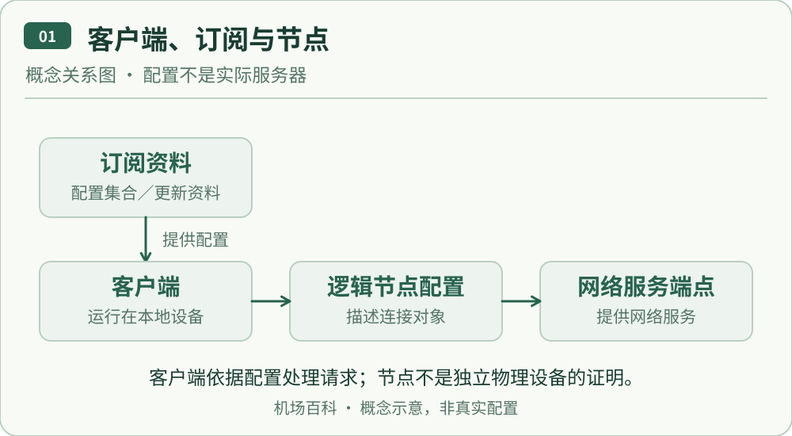

# 机场节点是什么？代理节点、订阅与服务器详解

<!-- 机场百科｜文章05｜V1.0 最新审核稿｜首次完整正文，未发布｜2026-11-20 -->

机场节点是中文网络服务中经常出现的术语。第一次接触时，人们可能把节点理解为一台服务器、一条线路或一个地区，但这些概念并不完全相同。一份订阅中看到几十个节点名称，也不能证明服务商拥有同样数量的物理服务器。本篇从网络配置的角度解释机场节点及相关概念，帮助读者正确阅读服务规格和保护自己的配置资料。

## 机场节点是什么意思？

在本文语境下，节点通常指客户端可以识别的一项代理连接配置。它描述如何与某个网络端点建立通信，可能包含连接对象、协议类型、认证信息以及其他参数。不同软件和服务商对节点的命名方式并没有统一的营销标准，因此不应只凭名称判断背后的网络结构。

节点可以指向实际服务器，也可能指向负载分配系统、转发端点或某个虚拟服务入口。两个看起来不同的节点可能共享服务器或部分网络资源；一个逻辑入口也可能对应多个后台资源。没有可信的架构资料时，这些关系只能保持未知。

## 客户端、节点与服务器的区别

客户端是用户设备上的软件，用于解释配置、处理相应网络请求。逻辑节点是软件可以选择的配置对象，服务器则是网络上提供服务的一端。把这三者混为一谈，就容易误以为安装了软件便自动获得服务资源，或者认为软件本身决定了所有网络性能。

```text
订阅资料（配置集合）
        |
        v
客户端 ---- 逻辑节点配置 ---- 网络服务端点
  |
  +---- 设备与本地网络
```



这是原创概念示意，不是具体连接配置。实际请求的处理范围取决于软件、操作系统及相应设置；图中的逻辑节点也不是必须存在的一台独立设备。

| 概念 | 作用 | 不代表什么 |
| --- | --- | --- |
| 客户端 | 解析配置及处理网络通信 | 自动提供服务器或订阅 |
| 节点 | 描述一种逻辑连接对象 | 一定有独占服务器 |
| 服务器 | 提供网络服务或相关资源 | 一定只对应一个节点 |
| 订阅 | 分发、更新配置资料 | 单个协议或固定文件格式 |
| 线路 | 描述网络连接路径或通信服务 | 已经确认的性能等级 |

客户端的系统支持与软件定位见[代理客户端对比](../clients/client-comparison.md)。

## 一个节点通常包含哪些信息？

从配置模型来看，一个节点一般需要有可识别的名称、连接对象信息、协议类型，以及协议所需的认证或通信属性。名称供界面显示，不一定参与真实通信；而地址、身份信息和通信属性等，则可能影响连接是否能够正确建立。

| 信息类别 | 作用 | 安全注意事项 |
| --- | --- | --- |
| 显示名称 | 方便区分配置 | 不作为地理位置证据 |
| 端点信息 | 描述网络服务对象 | 不公开私人配置截图 |
| 协议类型 | 表明通信规则 | 核对软件实际支持 |
| 认证资料 | 验证访问身份 | 不与陌生人分享 |
| 传输属性 | 描述通信相关要求 | 不随意忽略安全检查 |

这张表只解释概念，不提供实际节点地址、端口、认证值或可使用的配置。Mihomo 官方配置文档展示了代理对象与代理集合的组织方式；不同协议的技术区别参阅[代理协议区别](proxy-protocols.md)。

## 订阅链接与单个节点有什么区别？

单个节点描述特定连接对象；订阅通常用于向软件提供或更新一组配置。订阅返回内容的格式可能由服务商、客户端和分发方式决定。一个订阅地址可能包含多条节点信息，也可能返回完整配置或其他形式的资料。不能因为地址以相似形式出现，就假设所有软件均能读取相同内容。

订阅还可能具有身份凭据的性质。如果分发链接带有访问令牌，持有完整地址的人可能取得相关资料。因此不要把真实订阅链接放入公开仓库、截图、聊天群或第三方在线转换工具。即使订阅使用 HTTPS，地址在其他场合泄露后仍可能被他人使用。HTTPS 解决通信中的部分安全问题，并不意味着链接可以随意公开。

此外，订阅更新和服务续费不是一件事。更新只表示获取配置资料，账号是否有效、服务是否到期及收费方式仍取决于服务条款。客户端能读取配置，也不代表该服务必然可以连接。格式兼容方面可阅读[Clash机场指南](../clients/clash-airport.md)。

## 节点名称、服务器与出口位置

地区标签通常用于帮助用户区分配置，但它可能来自服务商的命名规则，不能直接证明物理设备位置。出口地址显示的地理信息也可能来自第三方 IP 数据库，数据库记录、地址分配地及实际服务器部署地点不一定一致。

同样，“专线”“高速”“备用”可能是产品名称或线路公示。要确定技术含义，应查询服务商明确的资料，而不是用命名结果推断整条端到端路径。有关线路的概念区分，参阅[IEPL、IPLC、中转与直连](../network/line-types.md)。

## 为什么节点数量不等于服务器数量？

举一个不涉及真实服务的概念例子：同一个服务端点可能提供三种通信配置，客户端可以把它们展示成三个节点；另一种系统可能把多台后端资源组织在一个逻辑服务入口后面，客户端只显示一个节点。用户界面的数量无法单独说明后端资源规模。

同样，两个不同命名的节点即使表现不同，也可能是流量调度、配置差异或测量条件造成的。想判断资源是否真正独立，需要能够说明架构的官方资料或有足够证据支持的测试，不能凭节点列表作结论。

选择服务时更值得关注的是自己所需功能是否受到支持、是否有清楚的使用规则、出现问题时是否有反馈机制。额外的节点选项可能带来便利，但不应成为唯一判断依据。

## 节点配置的兼容性与安全边界

软件读取订阅时，至少涉及资料格式、解析逻辑、内核实现和版本支持等层次。界面出现节点名称，仅能表明软件识别了部分信息；是否支持所有属性、是否成功进行网络通信，还需要其他条件。不同平台也可能存在权限和功能差异。

看到来源不明的配置时，不应因为其能够被软件识别就认为它安全。配置可能带有附加规则、访问外部资源的声明，或者不符合使用者的隐私预期。应优先查阅可信软件的官方资料与服务说明，理解配置的来源及用途。关于订阅泄露和免费资源风险，阅读[机场避坑指南](../faq/airport-risks.md)。

## 机场节点常见问题

### 节点是越多越好吗？

不是。数量不能单独说明资源独立性、网络质量或使用价值，应结合实际需求与证据评估。

### 订阅地址可以公开用于截图教学吗？

不应公开完整真实地址。教学示例宜使用完全虚构且不可用的值，截图应检查文字、二维码及其他可能暴露凭据的区域。

### 节点失效是否意味着服务器停止运营？

不一定。配置过期、账户限制、软件不兼容及网络异常等都可能造成无法使用。需要结合可靠信息判断，不能仅凭一次失败确定原因。

## 资料来源与披露

- [Mihomo 代理集合官方文档](https://wiki.metacubex.one/en/config/proxy-providers/)：配置分发与代理对象概念。
- [Project X：VLESS 文档](https://xtls.github.io/en/config/inbounds/vless.html)和[VMess 协议文档](https://xtls.github.io/en/development/protocols/vmess.html)：不同通信协议的定位。
- 上述为A级技术资料，2026-11-20 检索核对。本篇示意及概念例子为原创，不含真实节点或实测数据。关联博客：机场志，相关页面未核验。
- 运营方关联博客可能涉及商业推广，详见[商业披露](../../DISCLOSURE.md)及[资料登记](../../SOURCES.md)。

[返回机场百科首页](../../README.md)
